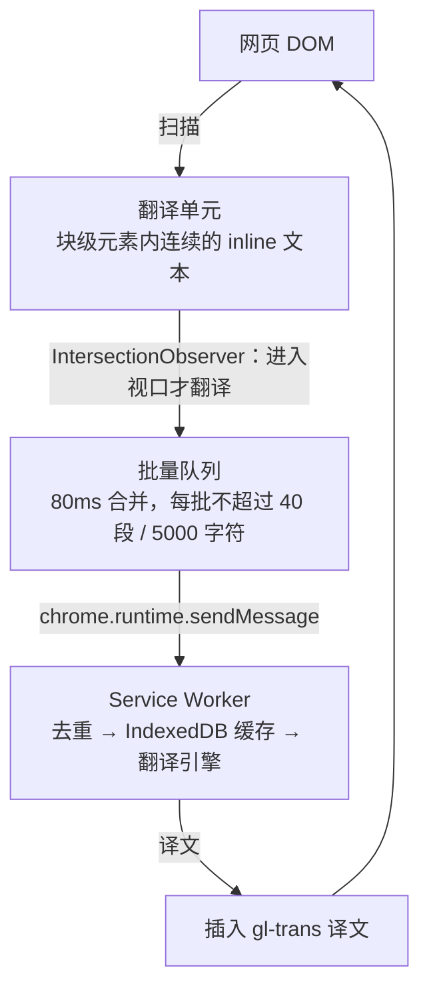

# 微光翻译 Glimmer

一款 Chrome 沉浸式双语翻译扩展（Manifest V3）。网页段落下方直接插入译文，原文译文对照阅读；支持划词翻译、悬停翻译、输入框翻译、生词本和 YouTube 双语字幕。界面参考 Trancy：深灰底色、右侧图标栏的侧边面板。

## 文档

| 文档 | 内容 |
| --- | --- |
| [更新日志](CHANGELOG.md) | 每个版本的功能更新、修复与修改记录 |
| [本地运行指南](docs/local-dev.md) | 本机运行扩展、跑测试、用本地 Supabase 与 Stripe 测试模式跑通注册和付款 |
| [后端部署指南](docs/backend.md) | Supabase 账户与 Stripe 订阅的配置、部署、联调 |
| [界面术语表](docs/ui-terms.md) | 面板、悬浮球、划词面板等每个界面区域的统一叫法，提修改意见时使用 |
| [架构设计说明](docs/architecture.md) | 分层架构、核心模块设计、数据流、关键决策与取舍、性能、安全、演进方向 |
| [配置指南](docs/configuration.md) | 引擎与会员等级、全部设置项说明、导入导出、快捷键 |
| [测试指南](docs/testing.md) | 自动化测试命令、手动测试清单、问题排查 |
| [项目上下文与交接说明](docs/project-context.md) | 当前进度、环境（云端 / 本地 / Stripe 沙盒）、协作规则、测试结果、下一步；新会话或新成员先读这篇 |
| [产品需求文档](docs/requirements.md) | 产品定位、会员方案、按模块编号的功能需求（含验收要点、对应测试用例、完成状态）、非功能需求、待决策事项 |
| [交互设计](docs/ux-design.md) | 产品心智模型、页面跳转、用户状态矩阵、关键流程与文案规范 |
| [测试用例](docs/test-cases.md) | 给测试人员：按用户全旅程（注册 → 免费翻译 → 开通会员 → 付费功能 → 取消）逐条验证，含会员权限矩阵与测试账号 |
| [开发指南](docs/development.md) | 架构、消息协议、整页翻译实现、新增引擎步骤、调试与发布 |
| [常见问题](docs/faq.md) | 安装使用、引擎与会员提示、YouTube 字幕、隐私、账户与订阅 |
| [示例配置](docs/settings.example.json) | 可在设置页“导入设置”直接导入 |

## 功能

| 功能 | 说明 |
| --- | --- |
| 网页双语对照 | 点击悬浮球或 `Alt+A`，按段落插入译文；只翻译进入视口的内容，滚动时懒加载，动态内容自动补译 |
| 仅显示译文 | 双语 / 仅译文一键切换（`Alt+S`），不改动原网页 DOM 结构 |
| 译文样式 | 默认、下划线、虚线、高亮、引用条、弱化、彩色、学习模式（模糊，悬停显示） |
| 欢迎页 | 首次安装打开：当场试一试双语效果、三步上手、快捷键 |
| 侧边面板 | 点击工具栏图标，在网页内从右侧滑出，再点一次收起（也可从悬浮球菜单“面板”打开）；右侧图标栏切换首页、设置、生词本，常用设置一步直达 |
| 划词翻译 | 选中文字出现图标，点击弹出翻译面板；可切换引擎、朗读、复制、收藏；中英自动互译 |
| 生词本 | 在划词面板点 ☆ 收藏单词或句子；面板首页列出“本页生词”，可展开释义、标记已掌握、朗读、移除 |
| 悬停翻译 | 按住 `Alt` 指向任意段落，只翻译这一段，再按一次还原 |
| 输入框翻译 | 在输入框末尾连按三次空格，把内容翻译成指定语言（默认英文，需在设置中开启） |
| YouTube 双语字幕 | 打开 CC 后自动显示原文 + 译文；自动生成字幕会合并成整句；鼠标移上字幕暂停，点击单词查词 |
| 账户与会员 | 邮箱或 Google 注册登录；Premium（$29 / 年）与 Premium+（$6 / 月或 $69 / 年）两档会员，Premium 方案页选择订阅，Stripe 安全支付，付完自动回到原页面并告知会员等级；可自助管理订阅；Premium+ 用量达到 80% 时提醒（后端：Supabase + Stripe） |
| 永不阻断阅读 | 默认引擎因未登录、等级不够或额度用完而不可用时，自动改用 Google 并提示一次原因 |
| 生词本云同步 | 会员的生词本自动同步到账号，换设备登录即可恢复；免费版最多 100 个 |
| 网站规则 | 总是翻译 / 永不翻译的域名列表 |
| 翻译缓存 | IndexedDB 缓存 30 天，相同文本不重复请求 |

## 翻译引擎

| 引擎 | 类型 | 需要 |
| --- | --- | --- |
| Google 翻译 | 机器翻译 | 免费，开箱即用（默认） |
| DeepL | 机器翻译 | Premium |
| Microsoft 翻译 | 机器翻译 | Premium |
| OpenAI GPT | 大模型 | Premium+ |
| Google Gemini | 大模型 | Premium+ |
| DeepSeek | 大模型 | Premium+ |
| Anthropic Claude | 大模型 | Premium+（每月 2000 万 Token） |

扩展里不填写任何 API Key：Google 由浏览器直接调用，其余引擎由后端的翻译代理调用，服务商 Key 只在后端。大模型翻译会把多个段落打包成一次请求（JSON 数组进、JSON 数组出），解析失败时自动降级为逐段翻译。

## 目录结构

```
manifest.json
src/
  shared/          settings.js（默认设置/读写）  languages.js（语言与各引擎代码映射）
  background/      index.js（消息路由、缓存、右键菜单、快捷键）  cache.js（IndexedDB）
                   account.js（登录、会员、翻译代理、生词同步）
    engines/       mt.js（Google）
  content/         content.js（页面翻译、悬浮球、划词、悬停、输入框）
                   content.css（页面内译文样式）  ui.css（Shadow DOM 内的 UI）
                   yt-hook.js（MAIN world 拦截字幕请求）  youtube.js（双语字幕渲染）
panel/             侧边面板（工具栏弹窗与网页内抽屉共用同一页面）
options/           完整设置页（含账户与会员分区）
premium/           Premium 方案页
welcome/           首次安装的欢迎页
styles/theme.css   共享主题
icons/
docs/              配置、测试、开发、后端部署文档与示例配置
supabase/          后端：数据库迁移、Edge Functions（翻译代理、Stripe 订阅）
tests/             e2e.py · e2e_real.py · e2e_account.py · e2e_local_billing.py（Playwright 端到端测试）  fixtures/（测试页）
```

## 测试

```bash
pip3 install playwright && python3 -m playwright install chromium
python3 tests/e2e.py          # 核心回归
python3 tests/e2e_real.py     # 真实网站与交互
python3 tests/e2e_account.py  # 账户与订阅（模拟后端）
```

全部测试命令和手动测试清单见 [测试指南](docs/testing.md)，测试人员按 [测试用例](docs/test-cases.md) 逐条验收。

## 工作原理



完整的架构图、时序图和数据表关系图见 [架构设计说明](docs/architecture.md)。

- 跳过 `code`、`pre`、输入框、`translate="no"`、`.notranslate` 和已经是目标语言的文本
- “仅译文”模式通过 `font-size:0` 隐藏原文文本节点，不移动、不删除网页原有节点，对 React/Vue 页面更安全
- 悬浮球、划词面板放在 Shadow DOM 中，与网页样式互不干扰
- 侧边面板是扩展自己的页面（`panel/panel.html`），在工具栏中作为弹窗打开，在网页中以 iframe 抽屉打开，两处共用一套代码

## 已知限制

- 会员引擎需要后端配置服务商 Key；目前云端只配置了 DeepL 和 DeepSeek
- Supabase 自带邮件只发给项目成员，开放注册前需接入自有邮件服务
- 段落内的链接、加粗等格式不会保留到译文中（译文为纯文本）
- YouTube 字幕依赖播放器自身的字幕请求，需要先打开 CC；全屏时划词面板不可见
