# 架构设计说明

一款沉浸式翻译扩展，难点不在“调用翻译接口”——那只是一个 `fetch`。真正难的是三件事：**在任意网站上找对要翻译的文字，插入译文却不破坏网页，以及在额度和速度之间取得平衡。**

在这之上，产品还有两块独立的能力：一个在网页内滑出的侧面板（设置、生词本、账户都在里面），以及基于 Supabase 和 Stripe 的账户与订阅。前者要解决“扩展 UI 如何与任意网页共存”，后者要解决“付费状态如何可信”。

本文记录微光翻译的整体架构、每个关键决策的理由和被放弃的方案。读完你应该能回答：某个功能为什么放在这一层，改动它会影响谁。

> 本文讲“为什么这样设计”。产品要做什么见 [产品需求文档](requirements.md)，具体怎么改代码、怎么调试见 [开发指南](development.md)。
>
> 文中的图用 Mermaid 绘制，在 GitHub 上直接显示为图形；本地查看需要支持 Mermaid 的编辑器（如 VS Code 安装 “Markdown Preview Mermaid Support”）。修改图之后运行 `python3 tests/check_diagrams.py` 检查能否正常渲染。

---

## 一、设计目标与约束

### 目标

| 目标 | 衡量标准 |
| --- | --- |
| 沉浸式阅读 | 译文紧贴原文段落，保留原网页排版，随时一键还原 |
| 多引擎 | 机器翻译和大模型可自由切换，新增引擎改动不超过 4 个文件 |
| 省额度 | 只翻译看得见的内容，相同文本不重复请求 |
| 不破坏网页 | 在 React、Vue 等框架驱动的页面上开关翻译，页面功能不受影响 |
| 零构建 | 原生 JavaScript，克隆后直接“加载已解压的扩展程序”即可运行 |
| 账户可选 | 不登录也能使用全部翻译方式（Google）；账户用于开通会员和同步生词本 |
| 永不阻断阅读 | 付费引擎不可用时自动改用 Google，翻译从不因会员状态整页失败 |
| 付费状态可信 | 会员状态只由服务端根据 Stripe 通知写入，客户端无法篡改 |

### 约束

- **Manifest V3。** 后台是 Service Worker，空闲约 30 秒后会被浏览器终止，不能依赖常驻内存
- **内容脚本运行在隔离世界（isolated world）。** 能操作 DOM，但看不到网页自己的 JavaScript 变量，也拦截不到网页发出的请求
- **网页环境不可控。** 任意 CSS、任意 DOM 结构、内容动态加载、严格的 CSP
- **扩展里没有服务商 Key。** 免费的 Google 翻译由浏览器直连；DeepL、Microsoft 和大模型由后端翻译代理调用，Key 只在服务器
- **只用托管服务。** 不自建、不运维服务器：账户和数据库用 Supabase，服务端逻辑写成 Supabase Edge Functions，收款交给 Stripe

这些约束直接决定了下面的分层。

---

## 二、整体架构

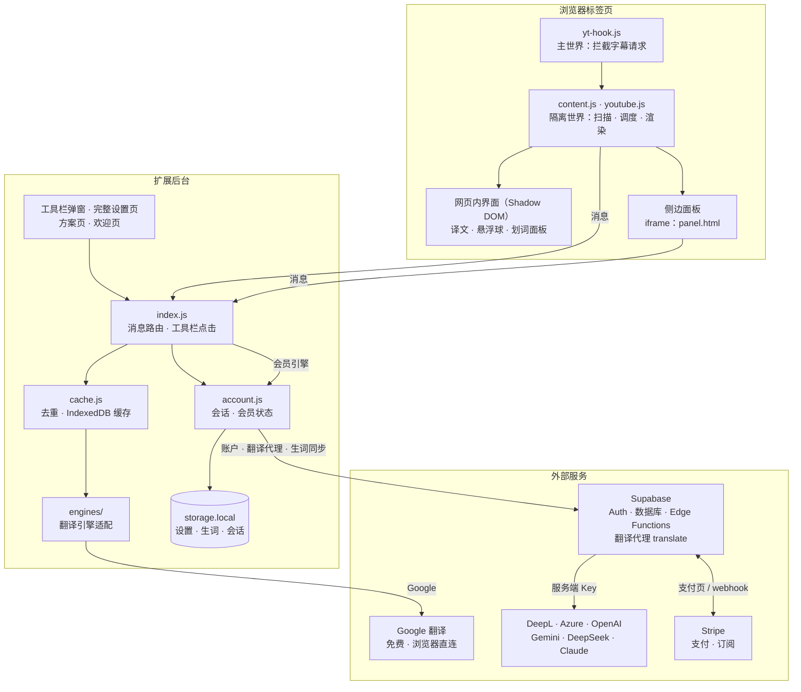

整个系统分六层，每层只做一件事：

| 层 | 文件 | 职责 | 不做什么 |
| --- | --- | --- | --- |
| 页面层 | `src/content/*` | 理解 DOM、调度、渲染、网页内交互、承载抽屉 | 不发网络请求，不碰登录令牌 |
| 服务层 | `src/background/index.js`、`cache.js` | 消息路由、去重、缓存、工具栏点击 | 不关心 DOM，不关心具体引擎协议 |
| 适配层 | `src/background/engines/*` | Google 翻译：把 `string[]` 翻译成 `string[]` | 不关心缓存和调用方 |
| 账户层 | `src/background/account.js` | 会话保存与续期、读取会员状态与用量、打开支付页、调用翻译代理、生词本同步 | 不决定会员等级和用量，只读取 |
| 界面与配置层 | `src/shared/*`、`panel/`、`options/`、`premium/`、`welcome/` | 设置的定义与读写；面板、完整设置页、Premium 方案页、欢迎页 | 不参与翻译流程，不直接调用后端 |
| 后端 | `supabase/` | 账户、会员数据、Stripe 支付与通知；会员引擎的翻译代理与用量计数；生词本云端存储 | 不保存翻译内容 |

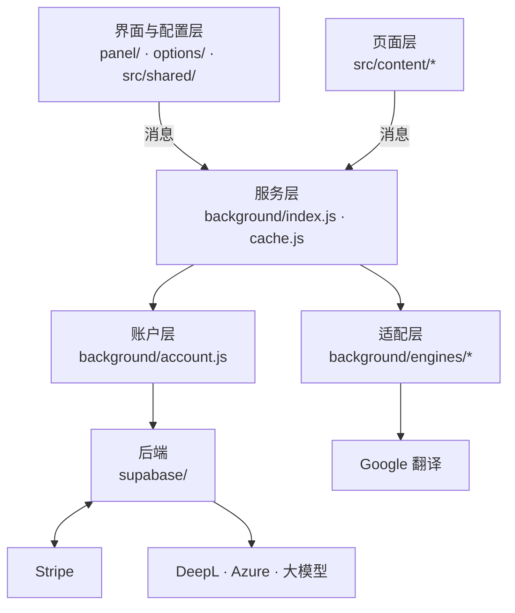

---

## 三、核心模块设计

### 3.1 DOM 扫描器：什么是“一段”

网页翻译的第一个问题是切分。按元素切太粗——一个 `<div>` 可能包着整篇文章；按文本节点切太细——`Hello <b>world</b>` 会被拆成两段，译文支离破碎。

扫描器的答案是 **“块级元素内连续的 inline 内容”** 为一个翻译单元：

```
<div>                                   单元 1：This div has direct text.
  This div has <b>direct</b> text.      ─────────────────────────────
  <p>A nested paragraph.</p>            单元 2：A nested paragraph.
</div>
```

算法分三步：

**第一步，收集文本。** `TreeWalker` 遍历文本节点，遇到 `SKIP_TAGS`（code、pre、输入框、svg 等）、`translate="no"`、可编辑区域时整棵子树跳过（`FILTER_REJECT`），不逐个检查后代。

**第二步，向上找块。** 每个文本节点沿父链上溯，直到遇到 `display` 不是 inline 的元素。`display` 的计算结果缓存在 `WeakMap` 中，同一元素只调用一次 `getComputedStyle`。

**第三步，按 inline 段切分。** 遍历块元素的直接子节点，块级子元素作为分隔符，其余节点累积成一段。两个特例：并列的 inline 元素之间没有文字（典型如导航栏链接）时逐个成段；行内 `code` 保留在段落内一起翻译。

已处理的文本节点记录在 `WeakSet` 中。这样动态内容重新扫描时只会处理新节点，节点被网页删除后也会被垃圾回收，不会内存泄漏。

**语言过滤** 在切分后进行：统计汉字、假名、谚文、拉丁字母的比例判断文本是否已经是目标语言。没有使用语言检测库——它们动辄几百 KB，而这里只需要回答“要不要翻”这一个二元问题。

### 3.2 调度器：什么时候翻

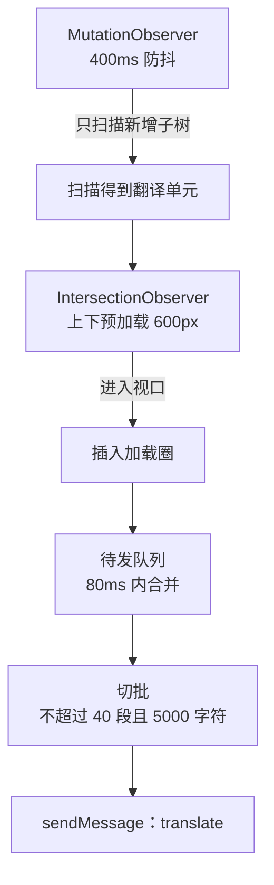

**为什么懒加载？** 一篇维基百科长文有几百段，用户通常只读前几屏。按视口翻译让首屏更快出结果，也让大模型的花费下降一个数量级。

**为什么 80ms 合并？** 滚动时视口回调会密集触发，每次只带一两个段落。短暂合并后一次发送，请求数显著减少，而 80ms 的延迟人眼几乎察觉不到。

**动态内容** 由 `MutationObserver` 监听，400ms 防抖后只扫描新增节点所在的子树，而不是整页重扫。扩展自己插入的 `<gl-trans>` 和 `<glimmer-ui>` 会被过滤，避免“插入译文 → 触发扫描 → 再插入”的循环。

**过期结果丢弃。** 每次开启或关闭翻译时 `state.gen` 自增，请求返回时比对代数，不一致就丢弃。用户在翻译中途关闭或切换引擎时，迟到的结果不会写回页面。

### 3.3 渲染器：怎么插而不破坏

译文统一放进自定义元素 `<gl-trans>`。用自定义标签而非 `<span>`，是因为网站 CSS 里大量存在 `span { ... }`、`p > span` 这样的选择器，自定义标签天然不会被命中。

插入位置有两种：

| 情况 | 插入位置 | 块元素标记 |
| --- | --- | --- |
| 纯单元（块里只有这一段） | 追加到块元素末尾 | `.gl-host` + 记录字号、边距到 CSS 变量 |
| 混合单元 | 该段最后一个节点之后 | 无 |

**“仅显示译文”模式是整个渲染设计的关键决策。**

| 方案 | 做法 | 问题 |
| --- | --- | --- |
| 替换文本 | 把原文本节点内容改成译文 | React 等框架下次渲染时会覆盖或报错；还原需要备份 |
| 包裹原文 | 把原节点移入 `<span hidden>` | 移动节点会破坏框架的虚拟 DOM 对应关系 |
| **字号归零（采用）** | `.gl-host { font-size: 0 }`，译文用 `--gl-fs` 恢复字号 | 只能用于纯单元；需要额外记录边距 |

采用的方案**不移动、不修改、不删除任何网页原有节点**，只加 class 和 CSS 变量。关闭翻译时删掉 `<gl-trans>`、移除 class，页面就回到原状。代价是 `em` 单位的边距会随字号归零，所以插入时把计算后的 `margin`、`padding` 以像素值存进 CSS 变量，在仅译文模式下用 `!important` 还原。

**译文样式** 全部由 `<html>` 上的 `data-gl-style`、`data-gl-mode` 属性和 `--gl-color` 变量驱动。切换样式只改三个属性，不需要遍历任何译文元素。

### 3.4 UI 隔离：Shadow DOM

悬浮球、划词面板、Toast 挂在 `<glimmer-ui>` 的 Shadow DOM 中，样式通过 `<link>` 加载扩展内的 `ui.css`。侧边面板也挂在这里，但它的内容是一个 iframe，原因见 3.8。

- **网页样式进不来**：网站的 `* { box-sizing }`、`button { }` 不会污染扩展 UI
- **扩展样式出不去**：扩展的 class 名不会和网站冲突
- **事件判定简单**：`event.composedPath().includes(uiRoot)` 即可判断点击是否发生在扩展 UI 内

YouTube 字幕层单独挂在播放器元素 `#movie_player` 内部，而不是页面根节点。原因是全屏时浏览器只渲染全屏元素的子树，挂在根节点上的字幕会消失。

### 3.5 服务层：去重与缓存

后台的 `translate` 处理流程：

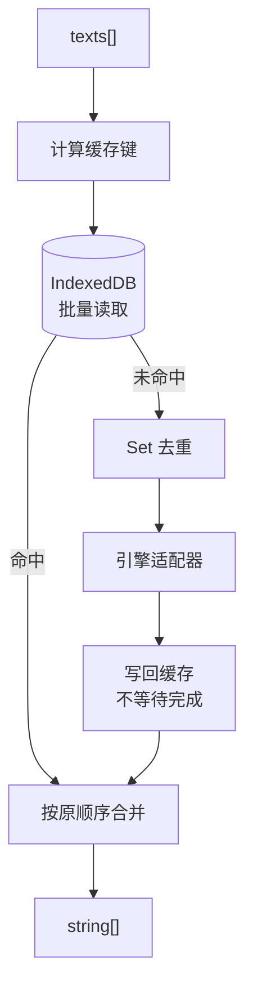

**缓存键** 为 `引擎 + 源语言 + 目标语言 + 原文`。模型和提示词由后端统一管理，扩展不知道也不需要知道；后端更换模型后，旧译文在 30 天内自然过期。

**为什么用 IndexedDB 而不是内存？** Service Worker 随时会被终止，内存缓存活不过一分钟。`chrome.storage.local` 也可以存，但它是整体读写的键值存储，不适合上万条小记录。IndexedDB 支持按键随机读写，条目带时间戳，30 天过期。

缓存写入不等待完成（fire-and-forget），读取失败时降级为全部未命中。缓存是优化而非依赖，坏了也不影响翻译。

### 3.6 适配层与翻译代理

引擎分两条路径：Google 翻译免费，由浏览器直接调用；其余引擎是会员功能，由后台把请求交给后端的 `translate` 函数，服务商的 Key 只在后端：

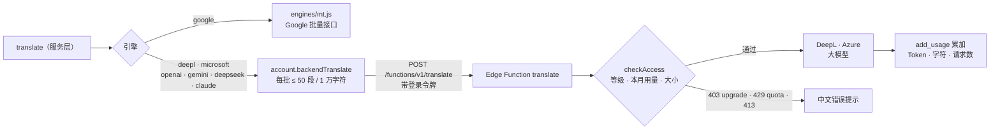

两条路径实现同一个契约：输入 `string[]`、输出等长同序的 `string[]`。服务商之间的差异封装在各自的实现里：

| 引擎 | 位置 | 批量策略 | 语言代码 |
| --- | --- | --- | --- |
| Google | 扩展 `engines/mt.js` | 每 64 段 / 4500 字符一个请求（`translate_a/t` 多 `q` 参数），并发 3；批量失败降级为逐段，限流（429）时不降级 | 原生 |
| Microsoft | 后端 `_shared/translate.ts` | 每 50 段一个请求（Azure Translator） | `zh-Hans` 等，查表转换 |
| DeepL | 后端 | 每 50 段一个请求；Key 以 `:fx` 结尾时走 Free 接口 | `ZH-HANS` 等，源语言只取主代码 |
| 大模型 | 后端 | 每 16 段 / 2400 字符打包成 JSON，并发 3 | 转为英文语言名写入提示词 |

**默认引擎不可用时自动改用 Google。** 不指定引擎的翻译请求（整页、悬停、输入框、字幕）先检查本地缓存的会员状态：未登录或等级不够时直接用 Google；调用失败时一律用 Google 重试一次——不只是后端返回的 `login` / `upgrade` / `quota`，后端连不上、登录过期、服务端出错、服务商 Key 未配置等任何故障都一样（原因记为 `error`，提示“X 暂时无法使用，已改用 Google 翻译”）。原因通过 `engineNotice` 发给发起的网页，每种原因每个浏览器会话只提示一次（记在 `storage.session`）。用户选择的引擎仍保存在设置里，开通或续费后自动恢复。指定了引擎的请求（划词面板手动选择）照常返回错误，由界面给出升级说明。

**超时。** 扩展的请求经过 `fetchT`：Google 20 秒、后端翻译代理 90 秒无响应即报错，网络不通时给出“无法连接到翻译服务”。没有超时的话，服务商卡住时段落会一直显示加载圈。

**为什么由后端代理？** 一是 Key 不出服务器，用户不必自己去各家申请；二是会员等级与用量只有在服务端校验才可信；三是模型、提示词可以统一调整，不用发新版本。代价是会员引擎的文本会经过我们的后端（只转发，不保存）。

语言代码转换集中在 `src/shared/languages.js`，后端复用同一张表。新增语言只改一处。

#### 大模型批量协议

大模型没有“批量翻译”接口，需要自己设计协议：

```
system: 专业译者提示词（{{to}} 替换为目标语言）
user:   Translate each string in the JSON array below into Simplified Chinese.
        Return ONLY a JSON object {"translations": [...]} containing exactly N strings...

        ["段落1", "段落2", ...]
```

模型输出不可信，所以解析是防御式的：去掉 Markdown 代码围栏，依次尝试整体解析、截取 `{...}`、截取 `[...]`，并校验数组长度等于 N。任何一步失败都**降级为逐段翻译**，用多花一点请求换取结果正确。

四家大模型的差异只在“发一次对话”这一步，抽象为 `chat(system, user) → { text, tokens }`，`tokens` 取服务商返回的输入 + 输出 Token 数，用于计量：

| 引擎 | 协议 | 差异点 |
| --- | --- | --- |
| OpenAI / DeepSeek | `/chat/completions` | 共用 `openaiCompatible`，仅地址和模型不同 |
| Gemini | `generateContent` | `systemInstruction` 独立字段 |
| Claude | `/v1/messages` | `system` 独立字段 |

### 3.7 YouTube 字幕：跨世界协作

内容脚本运行在隔离世界，拦截不到网页自己发出的 `fetch`。而 YouTube 的字幕请求带有播放器动态生成的签名参数，扩展自己构造请求会失败。

解决方案是 **在主世界放一个只做拦截的最小脚本**：

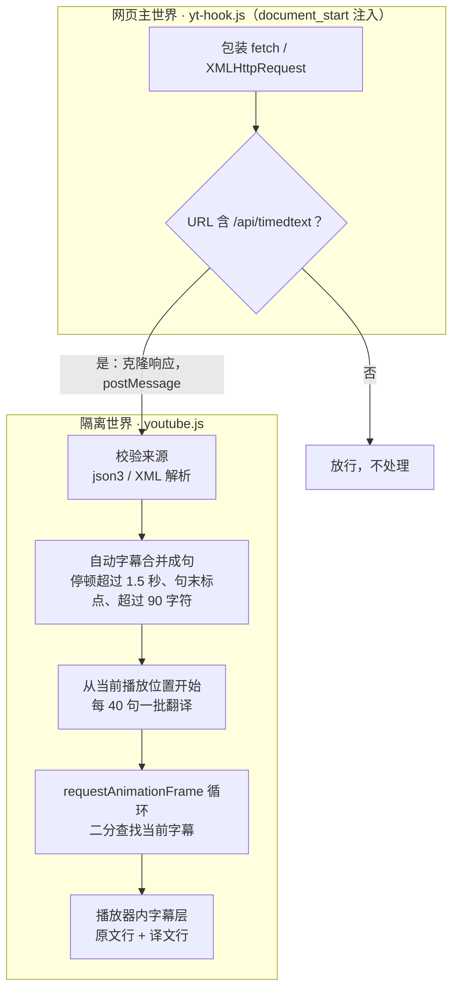

主世界脚本刻意保持极简：不读设置、不调用扩展 API、只转发数据。主世界里的代码对网页完全可见，越少越安全。

渲染采用 `requestAnimationFrame` 而非 `timeupdate` 事件，因为后者每秒只触发约 4 次，字幕切换会有明显延迟。每帧用二分查找定位当前字幕，索引未变时直接返回，不触碰 DOM。

### 3.8 面板：一个页面，两种形态

侧边面板需要出现在两个地方：网页内从右侧滑出的抽屉（点击工具栏图标或悬浮球菜单），以及无法嵌入网页时（`chrome://` 等内置页面）的工具栏弹窗。两处内容完全一样——首页、设置、生词本、账户、右侧图标栏。

| 方案 | 做法 | 问题 |
| --- | --- | --- |
| 两套实现 | 弹窗写一套，内容脚本在 Shadow DOM 里再写一套 | 代码重复；内容脚本不能 `import` 共享模块，设置逻辑要再抄一遍 |
| **一个扩展页面（采用）** | `panel/panel.html` 既作弹窗，又以 iframe 嵌入网页 | 需要把面板资源声明为 `web_accessible_resources` |

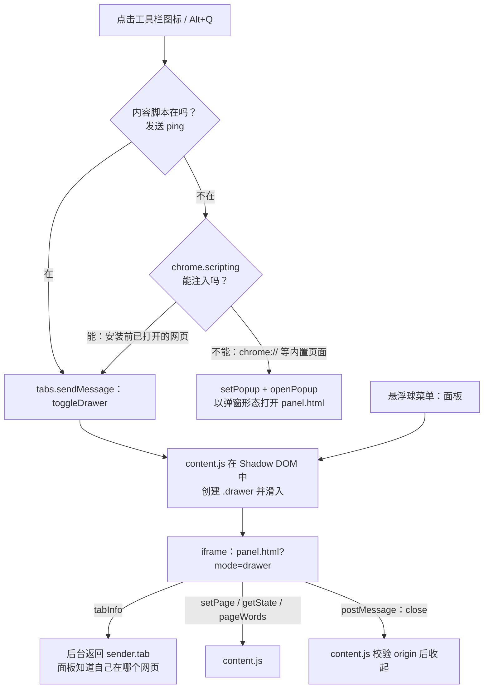

为什么悬浮球、划词面板用 Shadow DOM，侧边面板却用 iframe？前两者很小、要紧贴选区定位、只需展示几行文字，Shadow DOM 足够轻；侧边面板是一个完整应用，要读写设置、生词、登录令牌，用扩展页面才能直接使用扩展 API 和共享模块，也能把令牌留在扩展源内，网页读不到。

iframe 中的面板是扩展源（`chrome-extension://`）页面，可以直接使用全部扩展 API 和共享模块，与网页 JavaScript 完全隔离；网页无法读取 iframe 内容。抽屉打开时，悬浮球随之左移到抽屉边缘，避免被遮挡。

**状态同步** 不靠互相调用，而是靠两条广播：设置、生词、账户写入 `chrome.storage.local`，所有面板、完整设置页、方案页监听 `onChanged` 刷新；整页翻译开关由内容脚本广播 `pageStateChanged`。因此无论从悬浮球、快捷键、弹窗还是抽屉操作，各处显示始终一致。

**完整设置页复用面板的登录页。** 完整设置页的“账户与会员”分区未登录时，在弹窗 iframe 中加载 `panel.html?view=account`；登录成功写入 `auth`，设置页监听到后关闭弹窗并刷新分区。方案页的登录弹窗用的是同一个办法，登录逻辑只有一份。

### 3.9 后端：账户与订阅

免费的 Google 翻译不需要后端；账户、付费订阅、会员引擎的翻译代理和生词本云同步需要。后端只用两家托管服务，没有自建服务器：

| 职责 | 服务 | 位置 |
| --- | --- | --- |
| 注册、登录、令牌 | Supabase Auth | 托管 |
| 会员状态、用量、生词 | Supabase 数据库：`profiles`、`subscriptions`、`stripe_events`、`usage_monthly`、`words` | `supabase/migrations/` |
| 翻译代理、创建支付页、客户门户、接收通知、注册前检查邮箱域名 | Supabase Edge Functions（Deno） | `supabase/functions/` |
| 收款与订阅周期 | Stripe Checkout、客户门户、webhook | 托管 |

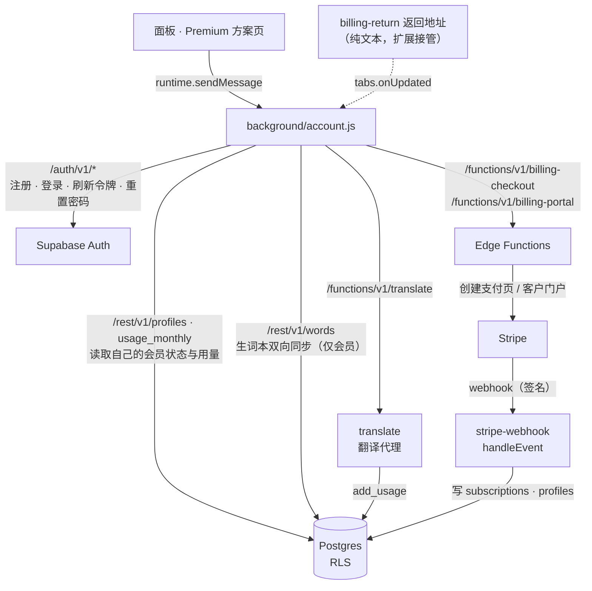

**一次订阅的完整过程：**

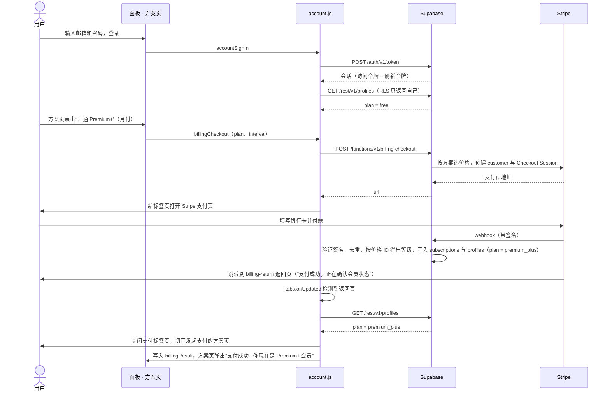

支付返回页打开时，webhook 可能还没到达，所以 `account.js` 在约 30 秒内多次刷新，直到会员等级达到所购方案。随后关闭支付标签页，切回发起支付的页面：发起页是方案页时弹出成功弹窗；是网页内的侧面板时在网页上提示；原页面已关闭时，支付标签页直接变成方案页。发起位置在点击“开通”时根据消息来源记下（没有 `tabs` 权限时读不到扩展页面标签的 URL），保存在 `storage.session`。30 秒内仍未确认时提示“支付已完成，会员正在开通”；取消支付和退出客户门户时同样回到原页面并提示。

**返回地址为什么不是网页。** 云端 Supabase 为防钓鱼，会把 `*.supabase.co` 上 GET 请求返回的 HTML 改成 `text/plain` 并加 `Content-Security-Policy: sandbox`，网页会原样显示成源代码，中文也因丢失 charset 变成乱码（本地后端没有这个限制，所以只在云端出现）。因此 `billing-return` 只返回一段带 UTF-8 的纯文本兜底，真正的结果由扩展显示：`tabs.onUpdated` 在地址刚变成返回地址时就接管标签页——支付结果回到发起页面，邮箱验证换成扩展内的 `welcome/verified.html`，只把 `#` 后的错误信息转交过去，登录令牌不离开地址栏也不进入扩展页面。以后有了自己的域名，可以把返回页放到官网上。

**已是会员时的升级。** Premium 会员在方案页点“升级到 Premium+”，`billing-checkout` 返回 409（`use_portal`），扩展改为打开客户门户，在门户中切换价格。这样同一用户始终只有一个订阅，门户会按比例计算差价。

**三个关键决策：**

- **扩展不引入 Supabase SDK，直接调用 REST 接口。** 项目没有构建步骤，SDK 需要打包；而扩展只用到注册、登录、刷新、读一张表、调两个函数，用 `fetch` 写一百多行就够了。会话保存在 `chrome.storage.local`，令牌在过期前 60 秒自动刷新，多个请求同时刷新时共用同一次刷新
- **会员状态只由服务端写入。** `profiles` 表只给登录用户开放“读自己”的 RLS 策略，没有 update 策略；套餐字段只有 webhook 用 service role 写入。用户即使拿到自己的令牌，也无法把自己改成会员；用量表同样只能由翻译代理通过 `add_usage` 写入
- **订阅逻辑与外部依赖分离。** `_shared/billing.ts` 只依赖注入的 `BillingDeps` 接口，不直接引用 Stripe SDK 和数据库客户端，因此能在单元测试中用内存数据库验证全部状态转换

**订阅到等级的映射：** 先看订阅状态：`active`、`trialing`、`past_due`（续费扣款失败的宽限期，界面提示更新支付方式）为有效，其余（`canceled`、`unpaid`、`incomplete` 等）为免费版。有效时再看价格 ID：`STRIPE_PRICE_PREMIUM_YEARLY` 为 Premium，两个 Premium+ 价格为 Premium+；未知价格按 Premium+ 处理，避免付费用户拿不到权益。用户设置“到期取消”时，到期前保持原等级。

**用量计数：** `usage_monthly` 以（用户、UTC 月份）为主键，`add_usage` 用一条 `insert … on conflict do update` 原子累加 Token、字符数和请求数，并发请求不会丢计数。超额检查在调用服务商之前做，所以单次请求最多超出额度一批的量。

**可靠性：** Stripe 可能重复或乱序投递事件。每个事件 ID 先写入 `stripe_events`，主键冲突即视为已处理；同步时总是以订阅对象的当前状态为准（`checkout.session.completed` 会重新获取订阅），而不是累加变化，因此乱序也能得到正确结果。处理失败返回 500，让 Stripe 稍后重试。

### 3.10 环境：云端、本地与测试

同一份扩展代码要连三种后端：发布版连云端，开发者 review 时连本机 Docker 里的 Supabase，自动化测试连 Python 模拟的接口。连哪一个由 `account.js` 的 `resolveBackend()` 按优先级决定：

| 优先级 | 来源 | 用途 |
| --- | --- | --- |
| 1 | 扩展存储中的 `backendOverride` | 测试注入模拟地址；开发版在完整设置页 → 高级 → “后端（开发版）”选择“本地”时写入 |
| 2 | `src/shared/config.js` 的 `BACKEND` | 云端项目“glimmer”，发布版只用这一项 |
| 3 | `LOCAL_DEV_BACKEND` | 未填写云端时，开发版（“加载已解压的扩展程序”）自动连 `127.0.0.1:54321` |

切换后端时同时清除登录会话：两个后端的用户和令牌互不相通，带着云端令牌去请求本地会得到 401。“开发版”由 `chrome.management.getSelf()` 的 `installType === 'development'` 判断，商店安装的用户看不到切换入口。

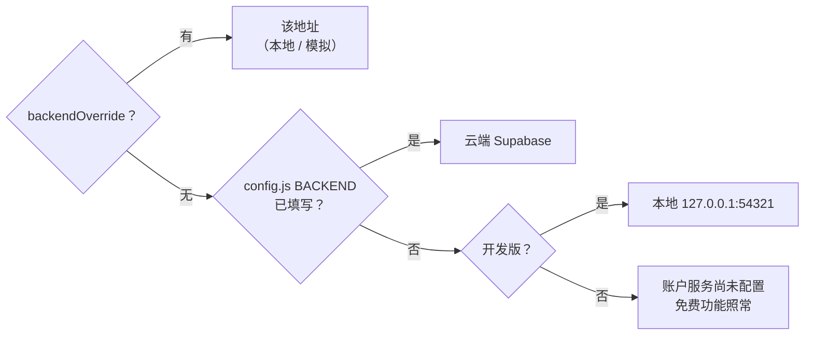

云端与本地共用同一套迁移、函数和 `config.toml`（Site URL、Google 登录、扩展跳回地址 `https://*.chromiumapp.org/**`），差别只在密钥文件：本地读 `supabase/functions/.env`，云端读 `supabase secrets`。

---

## 四、数据流

### 4.1 整页翻译时序

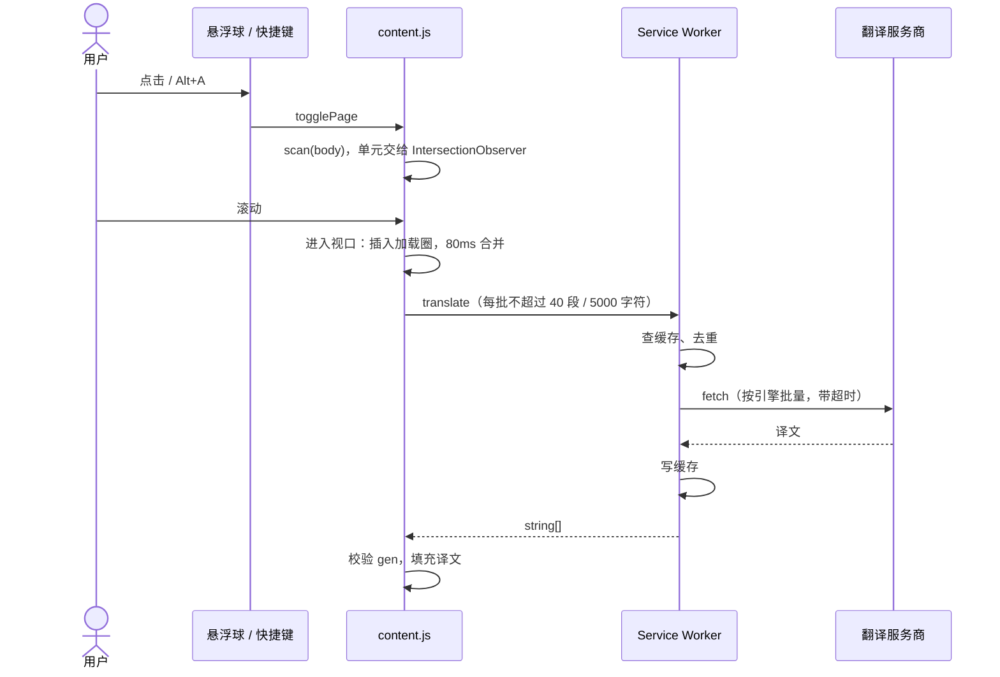

### 4.2 设置变更传播

`chrome.storage.local` 是设置的**唯一事实来源**。任何界面都不互相通知，只写存储：

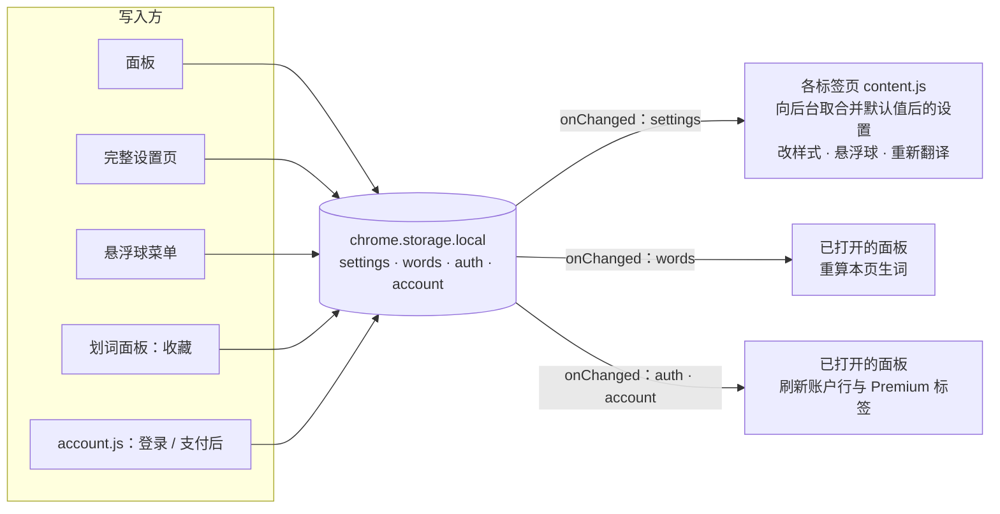

同样的机制也用于生词和账户：`words` 变化时，所有打开的面板重新计算“本页生词”；`auth`、`account` 变化时（登录、退出、支付后刷新），面板重新读取会员状态并更新账户行与 Premium 标签。

内容脚本收到变更后不直接使用 `newValue`，而是向后台重新请求。原因是存储里的值可能不完整（例如导入了只含部分字段的配置），合并默认值的逻辑只应存在一处。

### 4.3 数据模型

**设置**（`chrome.storage.local` 键 `settings`）：

```
settings
├── engine, sourceLang, targetLang       翻译基础
├── displayMode, transStyle, transColor  呈现
├── floatBall, selection{}, hover{}, inputTranslate{}, youtube{}   交互开关
└── alwaysSites[], neverSites[]          网站规则
```

读取时与 `DEFAULT_SETTINGS` 深合并：对象递归合并，数组整体替换。新版本增加设置项时只需在默认值里添加，老用户无需迁移脚本。旧版本留下的 `engines`、`llm`（API Key 与提示词）读取时丢弃，安装或更新时清除。

**生词本**（`chrome.storage.local` 键 `words`）：数组，最新在前，每项 `{ w: 原文, t: 译文, url: 来源页, ts: 时间戳, m: 是否已掌握, u: 最后修改时间 }`，按小写去重；免费版上限 100 条，会员上限 5000 条。删除记入 `wordsTombstones { 小写原文: 删除时间 }`，会员登录后与云端 `words` 表逐词比较修改时间，较新者为准，删除以墓碑形式同步到其他设备；本地变化 2 秒后自动同步。**生词本按账号分开**：`wordsOwner` 记录当前 `words` 属于谁（用户 ID 或 `guest`），其他账号的生词暂存在 `wordsStash[owner]`；`saveSession`（换了用户）与 `clearSession`（退出）时切换，未登录生词本在登录时并入该账号；同步写回前确认账号未变，避免换账号期间把旧账号的生词写进新账号。升级迁移：旧版本没有 `wordsOwner`，登录中则归当前账号；未登录时如果有 `wordsSyncedAt`（和云端同步过），说明是某个会员留下的，归为 `legacy` 单独存放、永不并入。“本页生词”由面板把整个生词表发给内容脚本，内容脚本对 `document.body.innerText` 分词后取交集，不额外存储。

**账户**（`chrome.storage.local`）：`auth` 保存会话 `{ access_token, refresh_token, expires_at, user }`；`account` 保存界面显示用的会员状态 `{ email, plan, status, periodEnd, cancelAtPeriodEnd, hasBilling, usage: { tokens, limit, month } }`（`plan` 为 `free` / `premium` / `premium_plus`），只是缓存，以数据库为准。

**缓存**（IndexedDB `glimmer-cache` / 对象仓库 `tr`）：键为缓存键字符串，值为 `{ v: 译文, t: 写入时间 }`。

**后端数据库**（Supabase Postgres，`supabase/migrations/`）：

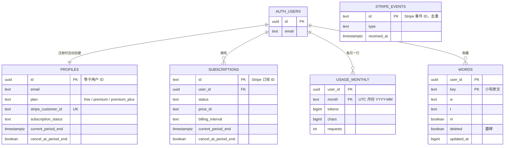

| 表 | 主要字段 | 谁能读 | 谁能写 |
| --- | --- | --- | --- |
| `profiles` | `id`（= 用户 ID）、`email`、`plan`（free / premium / premium_plus）、`stripe_customer_id`、`subscription_status`、`current_period_end`、`cancel_at_period_end` | 用户本人 | 注册触发器（创建）、Edge Functions |
| `subscriptions` | `id`（Stripe 订阅 ID）、`user_id`、`status`、`price_id`、`billing_interval`、`current_period_end`、`cancel_at_period_end` | 用户本人 | Edge Functions |
| `stripe_events` | `id`（Stripe 事件 ID）、`type`、`received_at` | 无 | Edge Functions（去重） |
| `usage_monthly` | `user_id`、`month`、`tokens`、`chars`、`requests` | 用户本人 | 翻译代理（`add_usage`，仅 service role 可执行） |
| `words` | `user_id`、`key`、`w`、`t`、`url`、`ts`、`m`、`deleted`、`updated_at` | 会员本人（`is_member`） | 会员本人 |

`profiles` 是面板读取的唯一来源，`subscriptions` 保留订阅明细，便于以后支持多个订阅或查账。

---

## 五、关键设计决策

| 决策 | 选择 | 放弃的方案 | 理由 |
| --- | --- | --- | --- |
| 网络请求位置 | 全部在 Service Worker | 内容脚本直接请求 | 令牌不进入网页进程；`host_permissions` 免除 CORS |
| 构建方式 | 原生 ES Modules，无构建 | TypeScript + Vite | 降低贡献门槛；代码量不足以抵消工具链成本 |
| 内容脚本 | 单文件 IIFE | 模块化拆分 | 内容脚本不支持静态 `import`；动态导入需暴露资源，增加攻击面 |
| 翻译时机 | 视口懒加载 | 整页一次翻完 | 首屏更快，大模型花费大幅下降 |
| 仅译文实现 | 字号归零 + CSS 变量 | 替换/包裹原文节点 | 不破坏框架管理的 DOM，还原零成本 |
| 译文容器 | 自定义元素 `<gl-trans>` | `<span>` / `<font>` | 不被网站 CSS 选择器命中 |
| 网页内小组件容器 | Shadow DOM（悬浮球、划词面板） | iframe | 更轻，可直接定位在选区旁 |
| 侧边面板容器 | iframe 加载扩展页面 | Shadow DOM | 完整应用，需要扩展 API、共享模块，令牌不能暴露给网页（见 3.8） |
| 语言判断 | 字符比例启发式 | 语言检测库 / 先调接口检测 | 零依赖、零请求，只需二元判断 |
| 缓存存储 | IndexedDB | 内存 / `storage.local` | SW 会被终止；大量小记录需要随机读写 |
| 设置存储 | `storage.local` | `storage.sync` | `sync` 单项限 8KB；生词本由我们的后端同步，不依赖 Google 账户 |
| 大模型批量 | JSON 数组协议 + 降级 | 分隔符拼接 | 分隔符可能被模型改写或翻译；JSON 可校验数量 |
| 面板实现 | 同一扩展页面兼作弹窗与 iframe 抽屉 | 内容脚本中再实现一套 UI | 一套代码；可直接用扩展 API 和共享模块；与网页隔离 |
| 后端 | Supabase（Auth + 数据库 + Edge Functions）+ Stripe | 自建 Node 服务器 | 账户、数据库、函数一站托管，免运维；Stripe 负责合规收款 |
| 扩展连接后端 | 直接调用 REST 接口 | 打包 Supabase SDK | 不引入构建步骤；所需接口很少 |
| 第三方登录 | Supabase OAuth + `chrome.identity.launchWebAuthFlow` | 在网页中打开 Supabase 登录页 | 授权在 Chrome 管理的独立窗口中完成，令牌直接回到扩展，不经过任何网页 |
| 会员状态写入 | 只由 Stripe webhook 经 Edge Function 写入 | 支付返回页由客户端上报 | 客户端可以伪造；webhook 有签名，是唯一可信来源 |
| 支付界面 | Stripe Checkout 与客户门户（跳转） | 在面板内嵌入支付表单 | 不接触银行卡信息，免去 PCI 合规；退款、发票、换卡由 Stripe 提供 |
| Microsoft 引擎 | Azure 官方 API（后端） | Edge 免费鉴权接口 | 后者已下线（返回 404），且属非官方用法 |
| 付费引擎的 Key | 全部放在后端，扩展经翻译代理调用 | 用户在设置页自填 Key | 用户无需申请 Key；等级与用量可在服务端校验；Key 不会随导出文件泄露 |
| 会员分档 | 免费 / Premium（机器翻译与云同步）/ Premium+（大模型 + 每月 Token） | 单一 Pro | 大模型成本远高于机器翻译，分档让价格与成本对应 |
| 用量单位 | 服务商返回的 Token 数 | 按字符或请求次数 | 与大模型成本直接对应；DeepL、Microsoft 不计 Token，只记字符 |

---

## 六、性能

| 手段 | 位置 | 效果 |
| --- | --- | --- |
| 子树整体跳过 | 扫描器 `FILTER_REJECT` | 代码块、SVG 等内部节点不逐个访问 |
| `display` 结果缓存 | 扫描器 `WeakMap` | 每个元素最多一次样式计算 |
| 视口懒加载 | 调度器 | 只处理可见内容 |
| 增量扫描 | `MutationObserver` | 只扫描新增子树 |
| 请求合并与批量 | 调度器 + 适配器 | 请求数减少一到两个数量级 |
| 去重 + 持久缓存 | 服务层 | 重复文本（导航、页脚、重访页面）零请求 |
| 字幕渲染短路 | YouTube 模块 | 字幕未切换时每帧只做一次二分查找 |
| Google 批量接口 | 适配层 | Hacker News 首页 65 段从 65 个请求、5–25 秒降为 2 个请求、约 1 秒 |
| 令牌刷新合并 | 账户层 | 多个请求同时发现令牌将过期时，只发一次刷新请求 |
| 会员状态本地缓存 | 账户层 | 面板打开即可显示，不等网络；后台再静默刷新 |
| 生词同步防抖 | 账户层 | 连续收藏多个词只触发一次同步 |

---

## 七、安全与隐私

- **扩展里没有服务商 Key。** DeepL、Azure 和大模型的 Key 只在 Supabase 函数环境变量中；扩展只持有可公开的 publishable key 和用户自己的登录令牌
- **翻译内容只转发不保存。** Google 翻译的文本由浏览器直接发给 Google；会员引擎的文本经后端 `translate` 函数转发给服务商，后端只记录字符数和 Token 数，不记录原文和译文
- **滥用防护。** 翻译代理要求登录，按等级校验引擎，Premium+ 有每月 Token 上限，单次请求最多 100 段 / 2 万字符
- **支付信息不经过我们。** 银行卡在 Stripe 的页面上填写，扩展和后端都接触不到；webhook 用 Stripe 签名验证，伪造的通知会被拒绝
- **密钥分级。** 扩展里只有可公开的 Supabase publishable key（旧称 anon key，数据安全靠 RLS）；secret / service_role key、Stripe 密钥、Google OAuth 密钥只存在 Supabase 的函数环境变量或被 git 忽略的 `.env` 中，提交前扫描
- **数据库最小权限。** 所有表开启 RLS；用户只能读自己的 `profiles`、`subscriptions`、`usage_monthly`，没有写权限；`words` 只有会员能读写自己的行；`stripe_events` 对用户完全不可见；`add_usage` 只授权给 service role
- **登录令牌。** 访问令牌和刷新令牌保存在扩展的 `storage.local`，网页无法读取；内容脚本虽然有权访问扩展存储，但代码中只有后台 `account.js` 读写令牌，面板只通过消息获取会员状态，不使用令牌；退出登录时同时通知 Supabase 作废会话。刷新令牌失效时自动退出，不会反复用无效令牌请求
- **主世界最小化。** `yt-hook.js` 只转发字幕数据，不读取设置、不调用扩展 API；内容脚本接收消息时校验 `event.source === window` 和 `source` 标识
- **面板隔离。** 抽屉是扩展源的 iframe，网页读不到其中内容；面板发出的 `postMessage` 只有“关闭”一种，内容脚本校验来源必须是本扩展。代价是 `panel/*` 等资源对网页可见，网站可借此探测扩展是否安装
- **输出转义。** 划词面板、字幕中的文本全部经过 HTML 转义或使用 `textContent` 写入，译文中的恶意内容不会被当作 HTML 执行
- **用户可控。** “永不翻译”名单用于邮箱、内网等敏感站点

---

## 八、扩展性

| 扩展场景 | 需要改动 |
| --- | --- |
| 新增会员引擎 | `settings.js` 的 `ENGINES` 注册（带 `tier`）→ 后端 `_shared/translate.ts` 的 `ENGINE_TIER` 与实现（大模型在 `chatFor` 加一项）→ 设置服务端 Key → `options.js` 卡片描述 → 方案页对比表 |
| 新增语言 | `languages.js` 加一行 |
| 新增译文样式 | `content.css` 加一组 `[data-gl-style]` 规则 → `options.js` 的 `STYLES` 加一项 |
| 新增视频网站字幕 | 仿照 `yt-hook.js` + `youtube.js`，在 `manifest.json` 中注册对应站点 |
| 新增会员功能 | 扩展用 `canUse` / `PLAN_RANK` 做界面提示；消耗服务端资源或存储数据的功能，必须在 Edge Function 或 RLS（`is_member`）中按 `profiles.plan` 校验 |
| 新增后端接口 | `supabase/functions/` 新建函数（复用 `_shared/`）→ `config.toml` 设置是否校验 JWT → `account.js` 加调用 → `index.js` 注册消息 |
| 新增登录方式 | Supabase 后台开启对应 Provider → `account.js` 用 `chrome.identity.launchWebAuthFlow` 完成 OAuth 跳转 |
| 新增设置项 | `DEFAULT_SETTINGS` 加默认值 → 设置页加带 `data-path` 的控件，自动双向绑定；需要在面板中出现时，在 `panel.js` 的 `PICKERS` 加一项 |

---

## 九、已知局限与演进方向

| 局限 | 影响 | 演进方向 |
| --- | --- | --- |
| 译文为纯文本 | 段落内的链接、加粗不会保留到译文 | 用占位符标记 inline 元素（如 `<a0>…</a0>`），翻译后还原为对应节点 |
| 并发限制只在单次请求内生效 | 同一页面的多个批次可能同时请求，触发服务商限流 | 在 Service Worker 中为每个引擎设置全局令牌桶 |
| 混合单元无法“仅显示译文” | 块内既有文字又有子块时，仅译文模式仍显示原文 | 对这类单元用 `<font>` 包裹文本节点，仅在确认非框架管理时启用 |
| 缓存键不含模型 | 后端更换模型后，旧译文要到 30 天过期才更新 | 后端在响应中返回模型版本，扩展把它加入缓存键 |
| 全屏时划词面板不可见 | YouTube 全屏下点词无反应 | 面板挂载点跟随 `document.fullscreenElement` |
| 无流式输出 | 大模型长段落需等待完整返回 | 单段翻译改用 SSE 流式，边生成边显示 |
| 仅支持 YouTube | 其他视频网站无双语字幕 | 抽象“字幕源”接口，按站点实现拦截与解析 |
| 依赖非官方 Google 接口 | 可能被限流或变更 | 后端增加 Google Cloud Translation 官方 API |
| 用量超额有一批的误差 | 额度检查在调用前，最后一批可能略超 2000 万 | 按请求预估 Token 预扣，返回后多退少补 |
| 会员状态是本地缓存 | 在 Stripe 后台直接操作订阅后，要等下次打开面板才更新 | 后台定时（如每 6 小时）刷新；需要服务端资源的会员功能始终以服务端校验为准 |
| 免费版生词本只在本机 | 免费用户换电脑或重装扩展会丢失 | 降级为免费版后保留云端数据，重新开通后恢复 |
| 邮件依赖 Supabase 自带服务 | 只发给项目成员，每小时几封；其他用户注册收不到验证邮件 | 云端接入自有 SMTP（如 Resend） |
| Stripe 仍是沙盒 | 只能用测试卡付款 | 上线前创建正式价格、webhook 与门户配置 |

---

## 写在最后

整个架构围绕一条原则展开：**对网页做加法，不做改法。** 扫描器只读，渲染器只插入自己的元素，仅译文模式只改样式，UI 关在 Shadow DOM 里。网页本身从未被修改，所以关掉翻译的那一刻，它就回到了原来的样子。

新增功能时，先问一句：这个改动是在网页上“加”东西，还是在“改”网页？如果是后者，值得再想想有没有别的办法。

账户与订阅则遵循另一条原则：**和钱有关的状态，只信服务端。** 客户端只读取、只缓存，从不决定谁是会员、用了多少。
