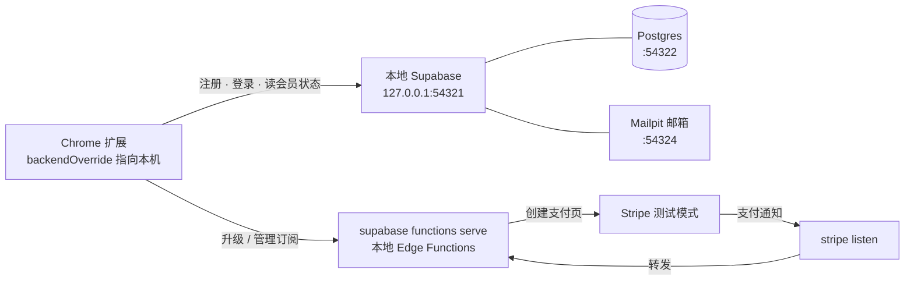

# 本地运行指南

在自己的电脑上把微光翻译跑起来，有三种程度，按需要选：

| 方式 | 能做什么 | 需要什么 | 用时 |
| --- | --- | --- | --- |
| **一、只运行扩展** | 网页翻译、划词、字幕、生词本、侧面板，以及所有不需要账户的功能 | Chrome | 5 分钟 |
| **二、运行自动化测试** | 验证改动没有破坏功能；账户与订阅用模拟接口测试 | Python、Playwright、Deno | 10 分钟 |
| **三、本地完整后端** | 在本机真实地注册登录、用 Stripe 测试卡开通 Premium / Premium+、经后端使用付费引擎 | Docker Desktop、Stripe 账号 | 30 分钟 |

大部分时候方式一就够了。只有要改动账户、订阅相关代码时，才需要方式三。

---

## 一、准备工具

| 工具 | 用于 | 检查是否已安装 | 安装 |
| --- | --- | --- | --- |
| Chrome 111+ | 运行扩展 | 地址栏打开 `chrome://version` | — |
| Git | 获取代码 | `git --version` | `brew install git` |
| Python 3 + Playwright | 自动化测试 | `python3 -c "import playwright"` | `pip3 install playwright && python3 -m playwright install chromium` |
| Deno | 后端单元测试、本地函数检查 | `deno --version` | `brew install deno` |
| Docker Desktop | 本地运行 Supabase（方式三） | `docker info` 不报错 | [docker.com](https://www.docker.com/products/docker-desktop/) 下载安装 |
| Node.js（npx） | 运行 Supabase CLI，不用全局安装 | `npx --version` | `brew install node` |
| Stripe CLI | 本地接收支付通知（方式三） | `stripe --version` | `brew install stripe/stripe-cli/stripe` |

---

## 二、方式一：只运行扩展

**第一步，获取代码。** 日常检查我的改动用本地 `dev` 分支：

```bash
cd /Users/wanghe/workspace/translator
git checkout dev
git merge --ff-only worktree-immersive-translator   # 拉入最新改动
```

**第二步，加载扩展。**

1. Chrome 打开 `chrome://extensions`，右上角开启“开发者模式”
2. 点击“加载已解压的扩展程序”，选择 `/Users/wanghe/workspace/translator`（包含 `manifest.json` 的目录）
3. 点击工具栏的拼图图标，把“微光翻译”固定到工具栏

**第三步，试用。** 打开任意英文网页，点击工具栏图标滑出侧面板，打开“翻译此页面”。Google 翻译开箱即用，不需要任何配置。

**第四步（可选），试用付费引擎。** DeepL、Microsoft 和大模型由后端代为请求，扩展里不填 Key。要在本机试用，需要按第三部分启动本地后端、在 `supabase/functions/.env` 中填好服务商 Key，并开通对应会员。引擎与会员等级见 [配置指南](configuration.md)。

**确认加载的是最新代码：** 完整设置页 → 高级 → “当前版本”，显示如 `v0.2.0 · c59de6a · 11-19 12:00`，与项目目录中执行 `git log --oneline -1` 的提交编号一致即为最新。磁盘上的代码更新后还没刷新插件时，设置页顶部和面板首页会显示黄色的“需要刷新”提示。

提交编号来自项目根目录的 `build.json`，执行 `sh scripts/write_build_info.sh` 生成。想在每次提交、合并、切换分支后自动更新，执行一次 `sh scripts/install-hooks.sh` 安装 git 钩子（可选）。没有 `build.json` 时显示代码指纹，同样能判断是否需要刷新。

**改了代码之后：**

| 改动的文件 | 需要做什么 |
| --- | --- |
| `src/background/**`、`src/shared/**`、`manifest.json` | `chrome://extensions` 中点击扩展卡片的刷新按钮 |
| `src/content/**` | 刷新扩展，**并刷新网页** |
| `panel/**`、`options/**` | 关闭面板或设置页后重新打开 |

> 同时只保留一个微光翻译。如果之前从其他目录（比如 worktree）加载过，先在扩展页移除它，否则两个扩展会同时运行。

---

## 三、方式二：运行自动化测试

在项目根目录执行：

```bash
python3 tests/e2e.py              # 核心回归，约 1 分钟
python3 tests/e2e_real.py         # 真实网站与交互，约 2 分钟（需联网）
python3 tests/e2e_account.py      # 账户与订阅，用模拟的 Supabase，约 30 秒
deno test --allow-env --allow-net --allow-read supabase/functions/   # 后端订阅逻辑
python3 tests/check_diagrams.py   # 文档中的图能否正常渲染
```

会员引擎（DeepL、大模型等）经后端翻译，要真实测试需要按下面第四部分启动本地后端，再运行 `python3 tests/e2e_local_billing.py`。

每个测试都会打印“结果：N/N 通过”，截图保存在 `tests/output/`。加 `--headed` 参数可以看到浏览器的操作过程。

---

## 四、方式三：本地完整后端

这一节让你在本机跑通真实的注册、登录和付款。所有服务都在本机，支付使用 Stripe 测试模式，不会产生真实扣款。

### 4.1 本地是怎么连起来的



需要同时开 **3 个终端窗口**，各跑一个常驻进程：

| 终端 | 命令 | 作用 |
| --- | --- | --- |
| 1 | `npx supabase start`（启动后可关闭窗口，服务在 Docker 中继续运行） | 数据库、账户、邮箱 |
| 2 | `stripe listen --forward-to …` | 把 Stripe 的支付通知转发到本机 |
| 3 | `npx supabase functions serve …` | 运行 4 个 Edge Functions |

### 4.2 启动本地 Supabase

**第一步，打开 Docker Desktop**，等菜单栏的鲸鱼图标显示“running”。

**第二步，在项目根目录启动：**

```bash
cd /Users/wanghe/workspace/translator
npx supabase start
```

首次运行会下载镜像，需要几分钟。完成后会打印一组地址和密钥，记下这几项：

| 输出中的名称 | 示例 | 用在哪 |
| --- | --- | --- |
| API URL | `http://127.0.0.1:54321` | 扩展的后端地址 |
| anon key（或 Publishable key） | `eyJhbGciOi…` 或 `sb_publishable_…` | 扩展的公开密钥，两种格式都可以 |
| Studio URL | `http://127.0.0.1:54323` | 网页版数据库管理，查看用户和会员状态 |
| Inbucket / Mailpit URL | `http://127.0.0.1:54324` | 本地邮箱，验证邮件、重置密码邮件都在这里 |

之后随时可以用 `npx supabase status` 再次查看。

**数据库表会自动创建**：`supabase start` 会执行 `supabase/migrations/` 中的建表语句。想清空数据重来时执行 `npx supabase db reset`。

### 4.3 准备 Stripe 测试数据

**第一步，登录 Stripe CLI：**

```bash
stripe login
```

浏览器会打开授权页面，确认后回到终端。CLI 默认使用你账号的测试模式。

**最快的方式：一条命令完成第二、三步。** 先在 `supabase/functions/.env` 填好 `STRIPE_SECRET_KEY`，然后执行：

```bash
python3 scripts/setup_stripe.py
```

脚本会创建两个产品（Premium、Premium+）、三个价格（Premium $29 / 年；Premium+ $6 / 月、$69 / 年）、客户门户配置，并把编号写入 `.env`。可以重复执行，已存在的会直接复用。想手动创建的话，按下面两步：

**第二步，创建两个产品和三个价格**（单位为分）：

```bash
stripe products create -d name="微光翻译 Premium"    # 记下 prod_A
stripe products create -d name="微光翻译 Premium+"   # 记下 prod_B

stripe prices create -d product=prod_A -d unit_amount=2900 -d currency=usd -d "recurring[interval]=year"
stripe prices create -d product=prod_B -d unit_amount=600 -d currency=usd -d "recurring[interval]=month"
stripe prices create -d product=prod_B -d unit_amount=6900 -d currency=usd -d "recurring[interval]=year"
# 依次记下三个 id：price_xxx
```

也可以在 Stripe 后台（右上角打开 Test mode）手动创建，效果相同。

**第三步，创建客户门户配置**（“管理订阅”需要）。用命令直接创建，不必去后台找设置页：

```bash
stripe billing_portal configurations create \
  -d "features[subscription_cancel][enabled]=true" \
  -d "features[payment_method_update][enabled]=true" \
  -d "features[invoice_history][enabled]=true" \
  -d "features[subscription_update][enabled]=true" \
  -d "features[subscription_update][default_allowed_updates][]=price" \
  -d "features[subscription_update][products][0][product]=prod_A" \
  -d "features[subscription_update][products][0][prices][]=price_premium_yearly" \
  -d "features[subscription_update][products][1][product]=prod_B" \
  -d "features[subscription_update][products][1][prices][]=price_plus_monthly" \
  -d "features[subscription_update][products][1][prices][]=price_plus_yearly" \
  -d "business_profile[headline]=微光翻译会员"
# 记下返回的 id：bpc_xxx，填入 .env 的 STRIPE_PORTAL_CONFIGURATION
```

也可以在 Stripe 后台保存默认的客户门户设置（Settings → Billing → Customer portal；沙盒账号的菜单位置可能不同，可在后台顶部搜索“customer portal”），这样就不用填 `STRIPE_PORTAL_CONFIGURATION`。

**第四步，在终端 2 转发支付通知（保持运行）：**

```bash
stripe listen --forward-to http://127.0.0.1:54321/functions/v1/stripe-webhook
```

启动后会打印 `Your webhook signing secret is whsec_…`，记下它。

### 4.4 运行 Edge Functions

**第一步，创建本地密钥文件** `supabase/functions/.env`（已被 git 忽略，不会提交）：

```bash
STRIPE_SECRET_KEY=sk_test_xxx            # stripe 后台 Developers → API keys 的 Secret key
STRIPE_WEBHOOK_SECRET=whsec_xxx          # 上一步 stripe listen 打印的值
STRIPE_PRICE_PREMIUM_YEARLY=price_xxx     # Premium $29 / 年
STRIPE_PRICE_PLUS_MONTHLY=price_xxx       # Premium+ $6 / 月
STRIPE_PRICE_PLUS_YEARLY=price_xxx        # Premium+ $69 / 年
PUBLIC_SUPABASE_URL=http://127.0.0.1:54321
STRIPE_PORTAL_CONFIGURATION=bpc_xxx       # 4.3 第三步创建的客户门户配置（可选）

# 翻译服务商（只填想试用的；变量说明见后端部署指南第四部分）
DEEPL_API_KEY=xxx
DEEPSEEK_API_KEY=sk-xxx
# AZURE_TRANSLATOR_KEY=xxx
# AZURE_TRANSLATOR_REGION=eastasia
# OPENAI_API_KEY=sk-xxx
# GEMINI_API_KEY=xxx
# ANTHROPIC_API_KEY=sk-ant-xxx
```

`PUBLIC_SUPABASE_URL` 只在本地需要：函数在 Docker 容器里看到的地址是 `http://kong:8000`，浏览器打不开，支付完成后的返回页必须用本机地址。`SUPABASE_URL` 和 `SUPABASE_SERVICE_ROLE_KEY` 由 CLI 自动注入，不用填。

**第二步，在终端 3 启动函数（保持运行）：**

```bash
npx supabase functions serve --env-file supabase/functions/.env
```

`supabase/config.toml` 中已经为 `stripe-webhook`、`billing-return` 关闭了 JWT 校验，本地和云端行为一致。

### 4.5 让扩展连接本地后端

> 目前 `src/shared/config.js` 已填写云端项目“glimmer”，插件默认连接云端，注册时验证邮件发到真实邮箱。本地后端的验证邮件不会发到真实邮箱，只能在 Mailpit（`http://127.0.0.1:54324`）中查看。

要让插件改连本地后端，打开 `chrome://extensions` → 微光翻译 → “Service Worker”，在 Console 执行：

```js
chrome.storage.local.set({ backendOverride: { supabaseUrl: 'http://127.0.0.1:54321', supabaseAnonKey: 'sb_publishable_ACJWlzQHlZjBrEguHvfOxg_3BJgxAaH' } })
// 改回云端：chrome.storage.local.remove('backendOverride')
```

更简单的办法：完整设置页 → 高级 → “后端（开发版）”直接选择“本地”或“云端”，效果相同（只在开发版显示，切换会退出登录）。

`config.js` 的 `BACKEND` 留空时，开发版会自动连接本机 Supabase，不需要上面这一步。

**预置测试账号**：`python3 scripts/seed_review_accounts.py` 在本地后端创建三个已验证邮箱的账号（`free@review.local`、`premium@review.local`、`plus@review.local`，密码 `review123`），分别为免费版、Premium、Premium+，可直接登录 review；可重复执行，用于重置。完整测试步骤见 [测试用例](test-cases.md)。

打开面板 → 设置 → 账户，看到登录表单、底部注明“后端：本地开发（127.0.0.1:54321）”即连接成功。本地后端没有启动时，操作会提示“本地后端没有运行”。

连接哪个后端的优先级：

| 优先级 | 来源 | 用途 |
| --- | --- | --- |
| 1 | 扩展存储中的 `backendOverride` | 测试，或临时指定其他地址（在扩展后台 Console 执行 `chrome.storage.local.set({ backendOverride: { supabaseUrl, supabaseAnonKey } })`，`chrome.storage.local.remove('backendOverride')` 取消） |
| 2 | `src/shared/config.js` 的 `BACKEND` | 正式发布时填写的云端地址 |
| 3 | 开发版自动使用本地后端 | 日常本地开发 |

### 4.5.1 本地开启 Google 登录（可选）

`config.toml` 已开启 Google 登录（`enabled = true`），本地和云端共用同一个 OAuth 客户端：

1. 按 [后端部署指南](backend.md) “开启 Google 登录”创建 OAuth 客户端，回调地址中包含 `http://127.0.0.1:54321/auth/v1/callback`
2. 在项目根目录创建 `supabase/.env`（已被 git 忽略）：
   ```bash
   SUPABASE_AUTH_EXTERNAL_GOOGLE_CLIENT_ID=xxx.apps.googleusercontent.com
   SUPABASE_AUTH_EXTERNAL_GOOGLE_SECRET=GOCSPX-xxx
   ```
   没有这个文件时本地 Supabase 会因缺少变量无法启动，可以临时把 `enabled` 改为 `false`
3. 重启本地 Supabase：`npx supabase stop && npx supabase start`

之后在面板的登录页点击“使用 Google 登录”即可。未开启时，点击会提示“尚未开启 Google 登录”。

### 4.6 跑通一遍

| 步骤 | 操作 | 预期结果 |
| --- | --- | --- |
| 1 | 账户页 → 注册，填写任意邮箱（如 `me@test.local`）和密码 | 提示“验证邮件已发送” |
| 2 | 打开 `http://127.0.0.1:54324`，点开验证邮件中的链接 | 验证成功后跳到“邮箱已验证”页面 |
| 3 | 回到面板登录 | 显示邮箱和“免费版” |
| 4 | 面板首页右上角“Premium” → 方案页切到“月付方案” → “开通 Premium+” | 新标签页打开 Stripe 测试支付页 |
| 5 | 卡号 `4242 4242 4242 4242`，任意未来日期、任意 CVC、任意邮编，付款 | 跳到本机的“订阅成功”页面；终端 2 显示事件转发 `[200]` |
| 6 | 回到面板 | 几秒内变为“Premium+ 会员”，显示本月 AI 用量；首页右上角变为实心“Premium+” |
| 7 | 打开 Studio `http://127.0.0.1:54323` → Table Editor → `profiles` | 该用户的 `plan` 为 `premium_plus` |
| 8 | 设置 → 翻译引擎选 DeepSeek 或 DeepL，翻译一个网页 | 译文正常；`usage_monthly` 出现本月记录，账户页用量增加 |
| 9 | 收藏一个生词 | 几秒后 `words` 表出现该词 |
| 10 | 账户页 → 管理订阅 → 取消订阅 → 返回 | 显示“已取消续费，Premium+ 有效期至……” |

其他测试卡：`4000 0000 0000 0341`（绑定成功、续费时扣款失败，可测试 `past_due`）、`4000 0025 0000 3155`（需要 3D 验证）。

**自动跑一遍**：服务都启动后，执行 `python3 tests/e2e_local_billing.py`，会自动完成注册、邮箱验证、登录、从方案页开通 Premium+、经后端用 DeepSeek 和 DeepL 翻译并记录用量、生词本云同步、到期取消，共 COUNT 项检查。Stripe 支付页和客户门户是第三方页面，加载慢时自动化填写不稳定，脚本会改用 Stripe API 完成同样的付款与取消操作（输出中会注明），后续通知、数据库、扩展刷新的验证完全一致。

想直接模拟某个事件，不经过支付页：

```bash
stripe trigger customer.subscription.updated
```

### 4.7 用完之后

```bash
# 停止本地 Supabase（数据会保留，下次 start 继续使用）
npx supabase stop
```

终端 2、3 按 `Ctrl+C` 结束。

---

## 五、常见问题

| 现象 | 原因与处理 |
| --- | --- |
| `npx supabase start` 报 “Cannot connect to the Docker daemon” | Docker Desktop 没有启动，打开后等它显示 running |
| `supabase start` 报端口被占用 | 之前的实例没停：`npx supabase stop`，或在 Docker Desktop 中停止 `supabase_*` 容器 |
| 账户页提示“账户服务尚未配置” | 插件不是以开发版方式加载，或 `backendOverride` 被设成了空地址：在扩展后台 Console 执行 `chrome.storage.local.remove('backendOverride')` |
| 点击工具栏图标没反应 | 先看完整设置页“当前版本”是否提示需要刷新；在 `chrome://extensions` 点击插件的“刷新”，再点微光翻译卡片上的“错误”查看报错 |
| 注册提示“无法连接账户服务” | 本地 Supabase 没在运行，执行 `npx supabase status` 检查 |
| 收不到验证邮件 | 本地不会真的发邮件，去 `http://127.0.0.1:54324` 查看 |
| 点击“月付”提示“缺少环境变量” | `supabase/functions/.env` 缺项，或启动函数时没加 `--env-file` |
| 付款后跳转到 `http://kong:8000/…` 打不开 | `.env` 中没有设置 `PUBLIC_SUPABASE_URL=http://127.0.0.1:54321`，补上后重启终端 3 |
| 付款成功但一直是免费版 | 看终端 2：没有事件说明 `stripe listen` 没在运行；显示 `[400]` 说明 `.env` 中的 `STRIPE_WEBHOOK_SECRET` 与 `stripe listen` 打印的不一致（每次重启 `stripe listen` 可能变化） |
| “管理订阅”报错 | 没有客户门户配置：按 4.3 第三步创建并填入 `STRIPE_PORTAL_CONFIGURATION`，或在 Stripe 后台保存默认设置 |
| 想把某个用户重置为免费版 | Studio 的 SQL Editor 执行 `update profiles set plan = 'free' where email = '…';` |

本地跑通后，部署到云端的步骤见 [后端部署指南](backend.md)。
