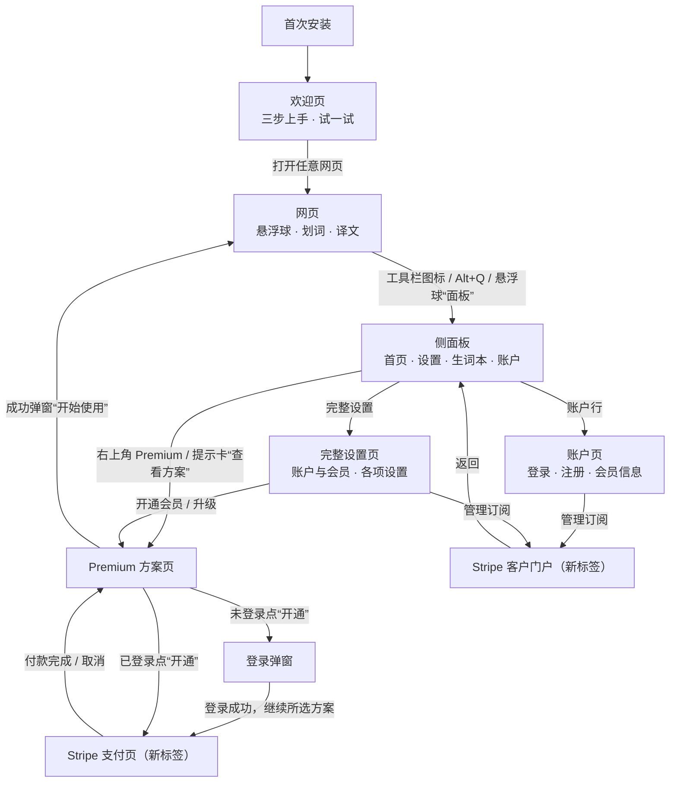
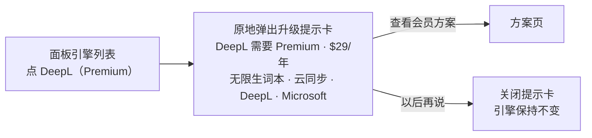

# 产品交互设计：让用户一眼看懂微光翻译

本文定义微光翻译“符合直觉”的交互逻辑：用户在每个页面看到什么、点了之后去哪、遇到限制时发生什么、付完钱之后回到哪里。界面改动以本文为准，测试用例 [test-cases.md](test-cases.md) 与本文保持同步；每项功能的需求与完成状态见 [产品需求文档](requirements.md)。

---

## 一、一句话心智模型

**打开网页就能翻译，免费；想要更好的译文和云端生词本，开通会员。**

用户只需要记住三个入口，其余都是从这三个入口延伸出来的：

| 入口 | 在哪里 | 用来做什么 |
| --- | --- | --- |
| **工具栏图标** | 浏览器右上角 | 打开侧面板：控制中心（翻译开关、引擎、生词本、设置、账户） |
| **悬浮球** | 网页右侧边缘 | 当前网页的快捷操作：翻译 / 仅译文 / 打开面板 |
| **选中文字** | 网页任意位置 | 划词翻译、收藏生词 |

会员是“锦上添花”，不是“使用门槛”：**任何情况下都不能让用户读不下去**。会员到期、额度用完、选错引擎时，自动改用免费的 Google 翻译，再告诉用户原因和解决办法。

---

## 二、五条交互原则

1. **永不阻断阅读。** 付费引擎不可用时自动改用 Google 翻译，并在网页上提示一次；绝不让整页显示“翻译失败”。
2. **先说明，再跳转。** 用户点到需要会员的功能时，先在原地弹出一张提示卡，说明“需要什么等级、多少钱、能得到什么”；用户点“查看方案”才打开新页面。
3. **从哪来，回哪去。** 付款、登录、管理订阅结束后，自动回到发起的页面，并明确告诉用户结果（“支付成功，你现在是 Premium+ 会员”）。
4. **付完钱马上能用。** 开通成功后直接给出“把默认引擎换成 DeepL / DeepSeek”的选项，一步就能用上刚买的功能。
5. **同一件事，同一种说法。** 按钮和提示的用词统一（见第六节），用户不用猜两个词是不是同一个意思。

---

## 三、页面与跳转

| 动作 | 去哪里 | 结束后回到哪里 | 告诉用户什么 |
| --- | --- | --- | --- |
| 点“开通 Premium+” | Stripe 支付页（新标签） | 方案页（支付标签自动关闭） | 成功：“支付成功 · 你现在是 Premium+ 会员”与解锁列表；取消：“已取消支付，没有产生任何费用” |
| 成功弹窗点“开始使用” | 打开方案页之前所在的网页 | — | 方案页关闭，回到原网页继续阅读 |
| 点“管理订阅” / “升级到 Premium+”（已是会员） | Stripe 客户门户（新标签） | 发起的页面 | “订阅已更新，当前为 Premium+ 会员” |
| 点未解锁的引擎 | 原地弹出升级提示卡 | 不离开 | 需要的等级、价格、权益 |
| 方案页未登录点“开通” | 方案页内的登录弹窗 | 登录后直接进入支付 | — |
| 完整设置页“账户与会员”点“登录 / 注册” | 设置页内的登录弹窗 | 登录成功后弹窗自动关闭 | 分区显示邮箱与会员等级 |

---

## 四、用户状态矩阵

| 状态 | 面板右上角 | 账户页 | 引擎列表 | 默认引擎不可用时 |
| --- | --- | --- | --- | --- |
| 未登录 | “Premium”描边标签 | 登录页 | 付费引擎带等级标签、灰色 | 自动改用 Google，提示“登录并开通会员后可使用 DeepL” |
| 免费版 | 同上 | 邮箱、“免费版”、开通会员卡片 | 同上 | 自动改用 Google，提示“DeepL 需要 Premium 会员” |
| Premium | 实心“Premium”带皇冠 | 会员信息、续费日期、“升级到 Premium+”、“管理订阅” | DeepL、Microsoft 可选；大模型灰色 | 选了大模型时自动改用 Google 并提示 |
| Premium+ | 实心“Premium+”带皇冠 | 同上 + 本月 AI 用量 | 全部可选 | 额度用完时大模型自动改用 Google，提示“本月 AI 额度已用完” |
| 会员已到期 | 变回“Premium”描边 | “免费版” | 同免费版 | 之前选的 DeepL 等自动改用 Google，面板首页显示“会员已到期”横幅与“续费”按钮；续费后自动恢复原来的引擎 |

**规则：** 用户选择的引擎始终保存，界面上实际使用的是“有效引擎”：选择的引擎可用就用它，不可用就用 Google。所以会员到期再续费后，不用重新设置。

---

## 五、关键流程

### 5.1 首次安装

| 现在 | 改为 |
| --- | --- |
| 自动打开完整设置页：几十个表单项，用户不知道从哪开始 | 打开**欢迎页**：① 把图标固定到工具栏；② 打开英文网页，点“翻译此页面”或按 `Alt+A`；③ 选中文字即可翻译、收藏生词。页面上有一段示例英文和“试一试”按钮，当场看到双语效果。底部一句话说明免费与会员的区别，不要求登录 |

### 5.2 免费用户想用付费引擎

划词面板里选了未解锁的引擎时，面板内显示同样的说明和“查看会员方案”按钮，而不是红色报错。

### 5.3 开通与回到阅读

1. 用户在网页上打开侧面板 → 点“Premium” → 方案页（记住来源网页）
2. 选择方案 → 未登录时先登录 → Stripe 付款
3. 付款完成 → 支付标签自动关闭 → 方案页弹出“支付成功 · 你现在是 Premium+ 会员”
4. 弹窗中选择默认引擎（DeepL / DeepSeek / 保持 Google）→ 点“开始使用” → 方案页关闭，回到来源网页

### 5.4 会员到期或额度用完

- 网页翻译自动改用 Google，网页上提示一次（每种原因每次浏览器会话只提示一次），提示中带“查看方案”或“续费”按钮
- 面板首页显示横幅：“DeepL 需要 Premium 会员，正在使用 Google 翻译 · 开通 / 改用 Google”
- 续费后自动恢复原来的引擎，横幅消失

---

## 六、文案规范

| 场景 | 统一用词 | 不要用 |
| --- | --- | --- |
| 登录页的第三方按钮 | “使用 Google 登录” | “继续使用 Google”（新用户分不清是登录还是注册） |
| 注册页的第三方按钮 | “使用 Google 注册” | 同上 |
| 第三方与邮箱之间 | 分隔线“或使用邮箱” | 无分隔 |
| 从免费到付费 | **开通**（开通 Premium） | 购买、订阅、升级 Pro |
| Premium 到 Premium+ | **升级**（升级到 Premium+） | 开通 |
| 改方案、改卡、取消、发票 | **管理订阅** | 账单、门户 |
| 付费引擎被拦 | “DeepL 需要 Premium 会员” | “错误 403”、“翻译失败” |
| 自动改用免费引擎 | “已改用 Google 翻译” | 静默切换 |

---

## 七、评审发现的问题与改造计划

| 优先级 | 问题 | 改造 |
| --- | --- | --- |
| P0 | 默认引擎未解锁（会员到期、导入旧设置）时，整页每段都显示红色“翻译失败，点击重试” | 自动改用 Google，网页提示一次；面板首页显示横幅（4.、5.4）（已完成）|
| P0 | 注册页的 Google 按钮写“继续使用 Google”，新用户不知道这是注册还是登录 | 按页面区分“使用 Google 登录 / 注册”，加“或使用邮箱”分隔线（已完成）|
| P0 | 付款后看不到结果 | 已修复：回到方案页并弹出成功提示 |
| P1 | 点未解锁的引擎时突然新开一个标签页 | 原地弹出升级提示卡，用户点“查看会员方案”才打开（已完成）|
| P1 | 划词面板选了未解锁引擎只显示红色报错 | 面板内显示需要的等级与“查看会员方案”（已完成）|
| P1 | 付款成功后不知道怎么用上新功能；“开始使用”只是关闭弹窗 | 成功弹窗提供“设为默认引擎”；“开始使用”回到来源网页（已完成）|
| P1 | 首次安装打开满屏表单的完整设置页 | 改为欢迎页（已完成）|
| P2 | 完整设置页没有账户与会员信息 | 加入“账户与会员”分区（已完成）|
| P2 | Premium+ 用量接近上限时没有预警 | 用量超过 80% 时账户页与面板首页提示（已完成）|
| P2 | 从未付费的用户也能看到“查看账单与发票” | 只对有过订阅的用户显示（已完成）|
